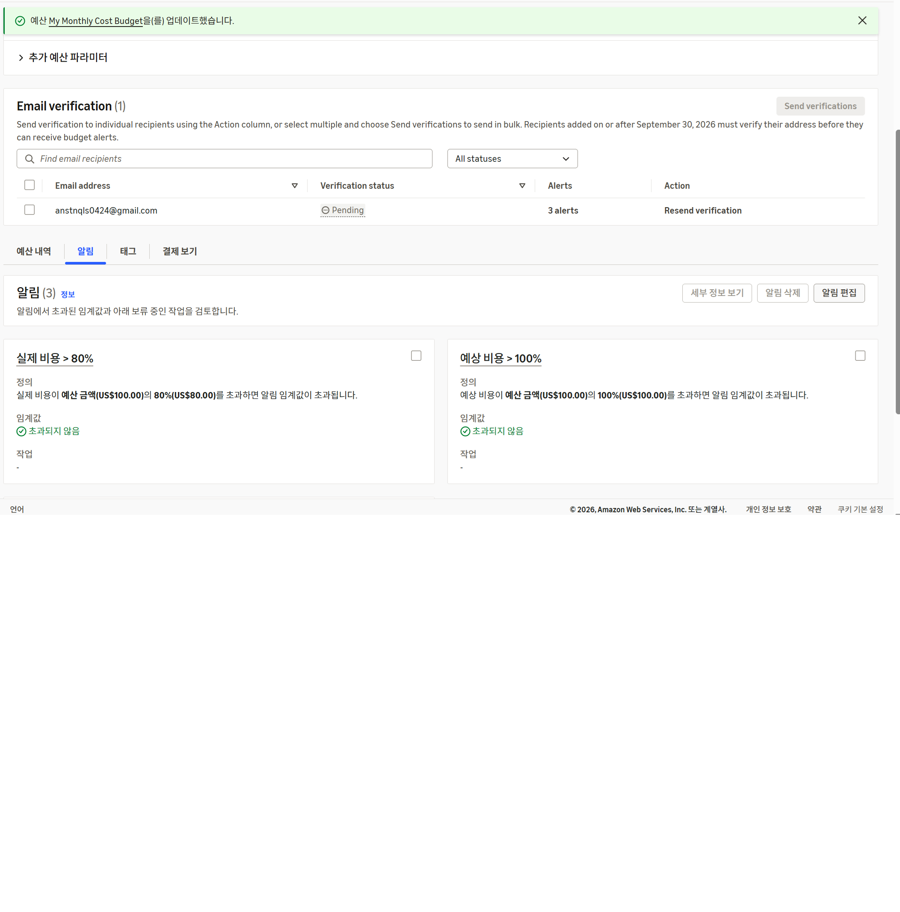

1.주요 기능 (Features)
팀원 관리 API (/api/members)
팀원 정보 등록 (POST)
전체 팀원 목록 조회 (GET)
특정 팀원 단건 조회 (GET)

서버 헬스 체크 (/actuator/health)
AWS EC2 배포 및 인프라 모니터링을 위한 서버 생존 여부 응답 ({"status":"UP"})

2.기술 스택 (Tech Stack)
Language: Java 17
Database: H2 In-Memory Database (MySQL Mode)
ORM: Spring Data JPA
Build Tool: Gradle
Environment: AWS EC2