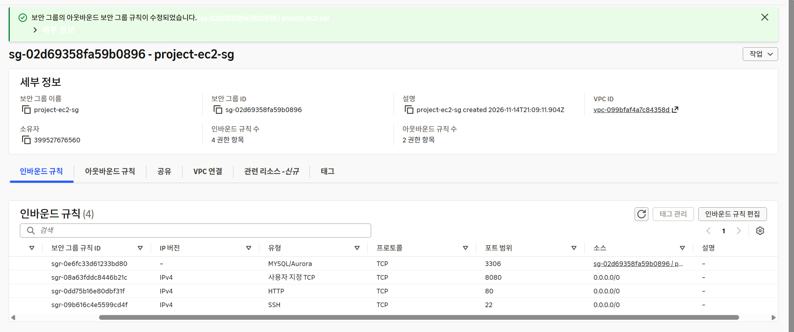
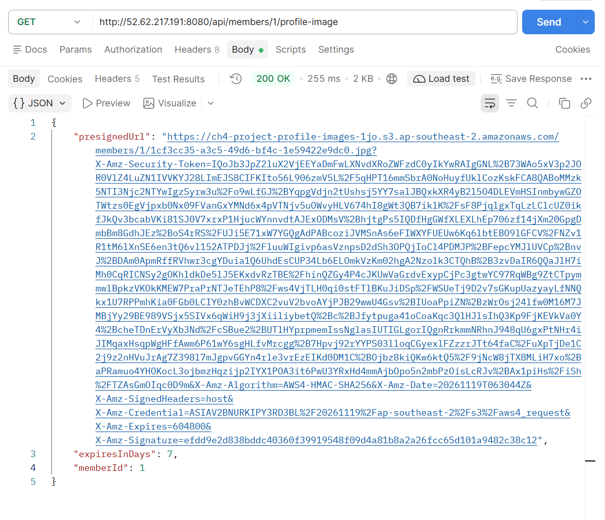
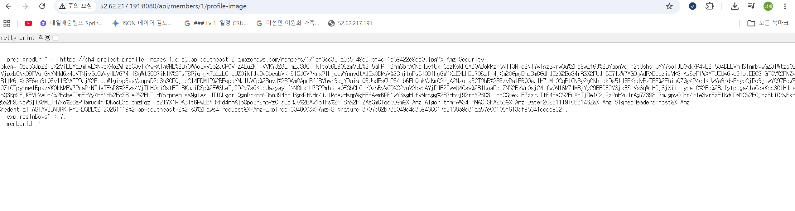
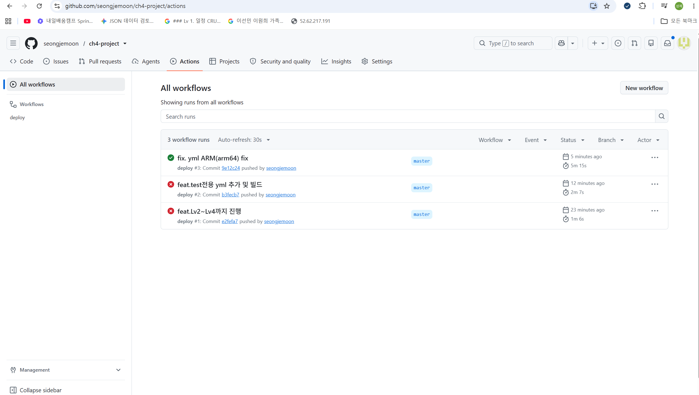
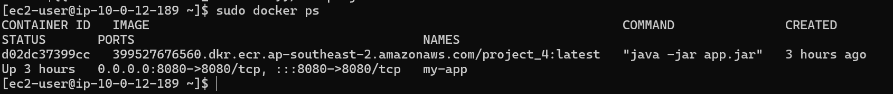

LV1.네트워크 구축 및 핵심 기능 배포
EC2 Public address: http://52.62.217.191:8080/

1.주요 기능 (Features)
팀원 관리 API (/api/members)
팀원 정보 등록 (POST)
전체 팀원 목록 조회 (GET)
특정 팀원 단건 조회 (GET)

서버 헬스 체크 (/actuator/health)
AWS EC2 배포 및 인프라 모니터링을 위한 서버 생존 여부 응답 ({"status":"UP"})

2.기술 스택 (Tech Stack)
Language: Java 17
Database: H2 In-Memory Database (MySQL Mode)
ORM: Spring Data JPA
Build Tool: Gradle
Environment: AWS EC2

LV2. DB 분리 및 보안 연결하기
http://52.62.217.191:8080/actuator/info
{"team":{"teamName":"1조","members":[{"name":"김명현","role":"리더","mbti":"INFP","blog":"https://velog.io/@myhyeoeo/posts","github":"https://github.com/myhyeoeo","message":"화이팅~~"},{"name":"정재원","role":"팀원","mbti":"INFP","blog":"https://velog.io/@luke1495/posts","github":"https://github.com/ApprendistaKR/Java_HomeWorks","message":"아직 실력이 많이 미숙하지만 잘 부탁드리겠습니다"},{"name":"문성제","role":"팀원","mbti":"INFP","blog":"https://tjdwp0728.tistory.com/","github":"https://github.com/seongjemoon","message":"1조 여러분들 잘부탁 드리겠습니다."},{"name":"이정현","role":"팀원","mbti":"ISFP","blog":"https://velog.io/@abocado/posts","github":"https://github.com/GreenAbocado","message":"잘 부탁드립니다~"},{"name":"김다현","role":"팀원","mbti":"INTP","blog":"https://velog.io/@kim_da/posts","github":"https://github.com/ITLulu-ux","message":"잘 부탁드립니다 "}]}}

LV3 프로필 사진 기능 추가와 권한 관리
postman

browser

LV4. Docker & CI/CD 파이프라인 구축
github action 탭 초록불 확인

도커 컨테이너 확인

